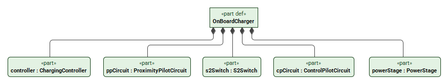
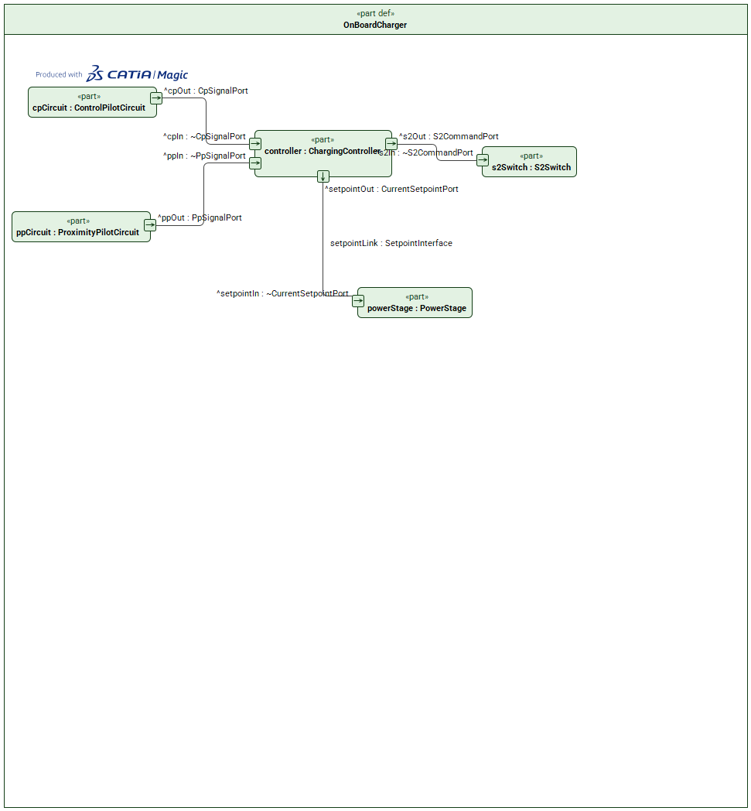
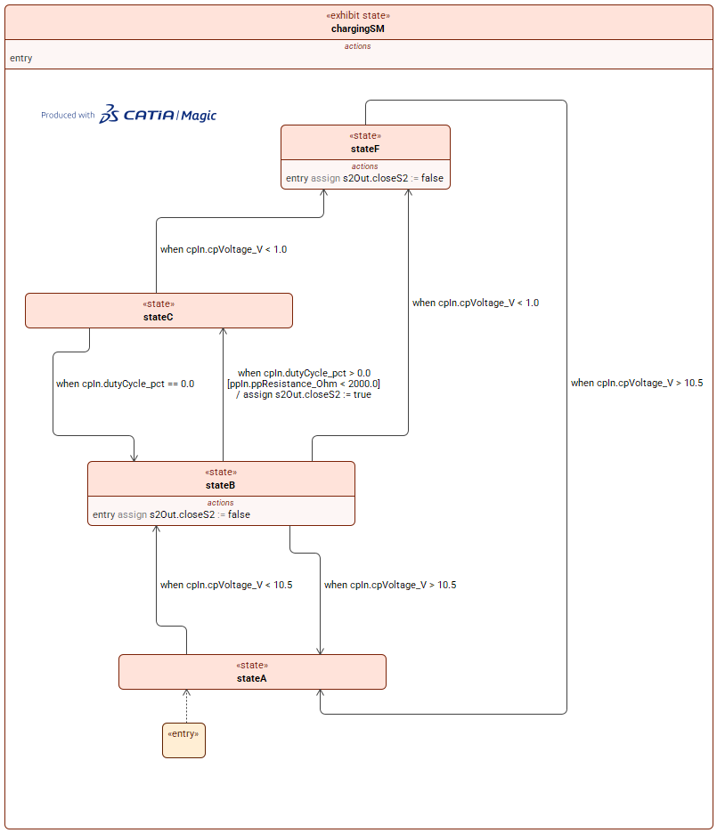
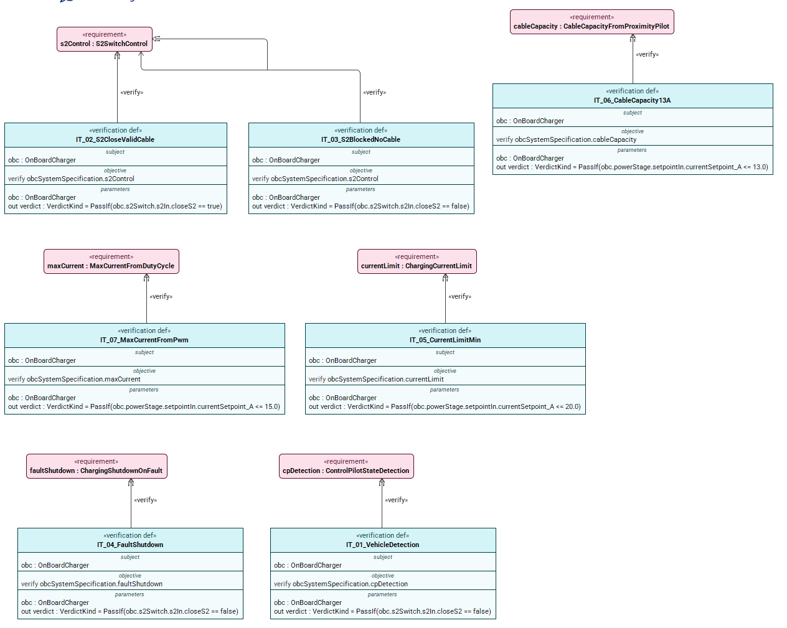

# OBC SysML v2 Model – Requirements, Architecture & Integration Tests in Cameo

A complete SysML v2 model of an **11 kW On-Board Charger (OBC)** for AC charging according to IEC 61851, built in **Cameo Systems Modeler / CATIA Magic 2026x (SysML v2)**.

The model follows one thread through the V-model: **requirements → architecture → interfaces → behavior → integration test cases**, with full traceability between them.

> Self-directed MBSE project (11/2026) by [Mostafa Elrafei](https://www.linkedin.com/in/mostafa-elrafei-b74532167/), based on my background in OBC control-pilot / proximity-pilot / S2 software. All values come from the public IEC 61851 standard; no company-confidential data is included.

## At a glance

| | |
|---|---|
| Requirements | 6 system requirements (SYS-001 … SYS-006) |
| Architecture | 5 parts, 4 typed interfaces, conjugated ports |
| Behavior | Charging state machine, states A / B / C / F, 7 transitions with triggers and guards |
| Verification | 7 integration test cases (verification defs) built from a reusable test-step library |
| Traceability | 100 %: every requirement is satisfied by a part and verified by at least one test |

## Traceability

| Requirement | Satisfied by | Verified by |
|---|---|---|
| SYS-001 Control pilot state detection | `cpCircuit` | IT_01_VehicleDetection |
| SYS-002 Max current from PWM duty cycle | `controller` | IT_07_MaxCurrentFromPwm |
| SYS-003 Cable capacity from proximity pilot | `ppCircuit` | IT_06_CableCapacity13A |
| SYS-004 S2 switch control | `s2Switch` | IT_02_S2CloseValidCable, IT_03_S2BlockedNoCable |
| SYS-005 Charging shutdown on fault | `controller` | IT_04_FaultShutdown (fault injection) |
| SYS-006 Current limit = min(CP limit, cable limit) | `controller` | IT_05_CurrentLimitMin |

## Diagrams

### Structure: what the OBC is made of


### Interconnection view: parts, ports and interfaces
The CP circuit, PP circuit, S2 switch and power stage are connected to the charging controller through typed interfaces. Receiving ports are conjugated (`~`).



### Behavior: IEC 61851 charging state machine
Transitions use `trigger [guard] / effect`. The B→C transition closes S2 only when the EVSE sends PWM **and** a valid cable is detected. Entering state F always opens S2, whichever path leads there.



### Verification: integration test cases and «verify» links
Each test drives the inputs through the real interfaces and checks the result at the **receiving end** of a wire (e.g. `s2Switch.s2In`), which is what makes it an integration test rather than a unit test. SYS-004 has a positive and a negative test (guard true / false); SYS-005 is covered by a fault-injection test.



## Example: an integration test case

```sysml
verification def IT_02_S2CloseValidCable {
    doc /* SYS-004 over cpLink, ppLink, s2Link: PWM + valid cable closes S2 (guard TRUE) */
    subject obc : OnBoardCharger;
    objective {
        verify '01_Requirements'::obcSystemSpecification.s2Control;
    }
    action plugIn : SetCpVoltage { in :>> voltage_V = 9.0; }
    then action cable : SetPpResistance { in :>> resistance_Ohm = 680.0; }
    then action pwm : SetPwmDutyCycle { in :>> duty_pct = 50.0; }
    then action settle : Wait { in :>> time_ms = 100.0; }
    then action check : CheckS2 { in :>> expectedClosed = true; }
    return verdict : VerdictKind = PassIf(obc.s2Switch.s2In.closeS2 == true);
}
```

## Repository structure

```
model/
  01_Requirements.sysml   requirement defs + system specification
  03_Structure.sysml      parts, wiring, state machine, variants, «satisfy» allocation
  04_Interfaces.sysml     port defs and interface defs
  05_Behavior.sysml       reusable test-step actions
  06_Verification.sysml   integration test cases IT_01 … IT_07
images/                   diagrams exported from Cameo
```

## How to open the model

The `.sysml` files are standard SysML v2 textual notation.

- **Cameo / CATIA Magic 2026x**: create a SysML v2 project, then *File → Import From → SysML v2 Textual Notation*. The free [CATIA Magic SysML v2 Community Edition](https://www.3ds.com/products/catia/catia-magic/sysmlv2) works.
- Any other SysML v2 tool or the OMG pilot implementation can read the text as well.

Diagram view definitions are Cameo-specific and are not part of the text files.

## Skills demonstrated

SysML v2 · MBSE · requirements engineering · def/usage modeling · ports & interfaces · state machines with guards · verification cases · requirement ↔ design ↔ test traceability · integration and fault-injection test design · IEC 61851 EV charging
